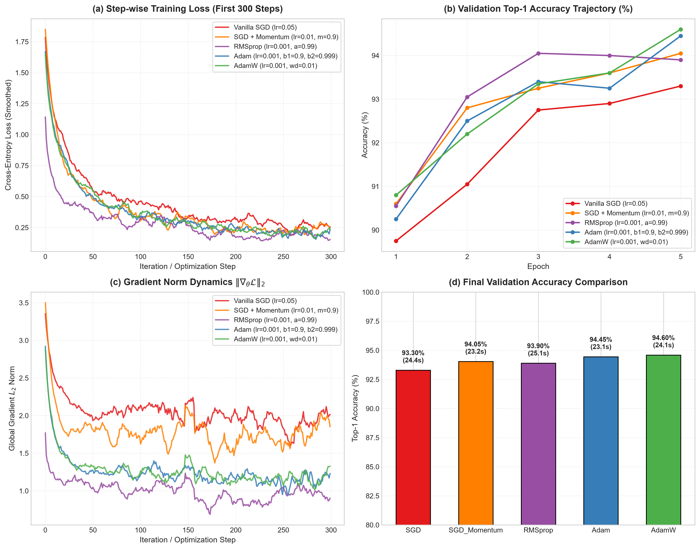

# Optimization Algorithms in Deep Learning: SGD vs. Adam & Adaptive Methods

[](https://www.python.org/downloads/)
[](https://pytorch.org/)
[](LICENSE)
[](https://github.com/GideonMwiti)

A production-grade empirical benchmark and mathematical dissection of first-order stochastic optimization algorithms in PyTorch: **Vanilla SGD**, **SGD with Polyak Momentum**, **RMSprop**, **Adam (Adaptive Moment Estimation)**, and **AdamW (Decoupled Weight Decay)**. Evaluated on the MNIST digit classification benchmark under strict **canonical weight initialization** ($\theta_0$) to guarantee identical starting loss surfaces and unbiased convergence comparisons.

---

## Visual Diagnostic & Convergence Dashboard

The experiment records step-wise training losses, epoch-level generalization curves, global gradient $L_2$ norm trajectories, and wall-clock convergence efficiency into an analytical 4-panel report:



*Figure 1: (a) Step-wise smoothed cross-entropy training loss over the first 300 optimization steps; (b) Validation top-1 accuracy trajectory across training epochs; (c) Global gradient $L_2$ norm dynamics ($\|\nabla_\theta \mathcal{L}\|_2$); (d) Final validation accuracy Pareto comparison with total execution duration.*

---

## Mathematical Foundations of Optimizers

Given an objective function parameterized by $\theta \in \mathbb{R}^d$, a mini-batch loss $\mathcal{L}(\theta)$, stochastic gradient $g_t = \nabla_\theta \mathcal{L}_t(\theta_t)$, and learning rate $\eta$:

### 1. Vanilla Stochastic Gradient Descent (SGD)

Vanilla SGD updates weights exclusively in the direction of the instantaneous negative gradient:

$$\theta_{t+1} = \theta_t - \eta g_t$$

- **Properties**: Unbiased expectation $\mathbb{E}[g_t] = \nabla \mathcal{L}(\theta)$. However, in ill-conditioned ravines (where curvature is steep in one dimension and shallow in another), SGD oscillates violently across the steep walls, leading to slow progress along the valley floor.

---

### 2. SGD with Momentum (Polyak & Nesterov)

Momentum accelerates SGD in the direction of persistent gradients and dampens high-frequency stochastic oscillations by accumulating an exponentially decaying velocity vector $v_t$:

$$v_{t+1} = \gamma v_t + \eta g_t$$
$$\theta_{t+1} = \theta_t - v_{t+1}$$

where $\gamma \in [0, 1)$ (typically $0.9$) denotes the momentum coefficient.

- **Nesterov Accelerated Gradient (NAG)**: Evaluates the gradient step ahead at the projected lookahead position $\theta_t - \gamma v_t$:
  $$g_t = \nabla_\theta \mathcal{L}(\theta_t - \gamma v_t)$$
  This provides an anticipatory "braking" mechanism that stabilizes optimization near sharp local minima.

---

### 3. RMSprop (Root Mean Square Propagation)

RMSprop addresses the diminishing learning rate problem of AdaGrad by maintaining an exponentially decaying average of past *squared* gradients:

$$v_t = \beta v_{t-1} + (1 - \beta) g_t^2$$
$$\theta_{t+1} = \theta_t - \frac{\eta}{\sqrt{v_t} + \epsilon} \odot g_t$$

where $\beta \in [0, 1)$ (typically $0.99$), $\epsilon = 10^{-8}$ prevents division by zero, and $\odot$ denotes Hadamard element-wise multiplication. By scaling coordinate updates inversely with their recent root-mean-square magnitude, RMSprop equalizes step sizes across anisotropic dimensions.

---

### 4. Adam (Adaptive Moment Estimation)

Adam combines the advantages of both Momentum (first raw moment $m_t$) and RMSprop (second uncentered moment $v_t$):

$$m_t = \beta_1 m_{t-1} + (1 - \beta_1) g_t, \quad v_t = \beta_2 v_{t-1} + (1 - \beta_2) g_t^2$$

#### Bias Correction
Because $m_0 = \mathbf{0}$ and $v_0 = \mathbf{0}$, estimates are biased toward zero during initial steps. Adam corrects this bias through time-step scaling:

$$\hat{m}_t = \frac{m_t}{1 - \beta_1^t}, \quad \hat{v}_t = \frac{v_t}{1 - \beta_2^t}$$

#### Weight Update
$$\theta_{t+1} = \theta_t - \frac{\eta}{\sqrt{\hat{v}_t} + \epsilon} \odot \hat{m}_t$$

Canonical parameters: $\beta_1 = 0.9, \; \beta_2 = 0.999, \; \epsilon = 10^{-8}$.

---

### 5. AdamW: Decoupled Weight Decay

In standard $L_2$ regularization, weight decay is added directly to the gradient before moment estimation:
$$g_t \leftarrow g_t + \lambda \theta_t$$
Loshchilov & Hutter (2019) proved that in adaptive optimizers, this leads to weights with large historical gradients being regularized *less* than weights with small gradients.

**AdamW decouples weight decay**, applying penalty directly to the parameters outside the moment accumulator:

$$\theta_{t+1} = \theta_t - \eta \lambda \theta_t - \frac{\eta}{\sqrt{\hat{v}_t} + \epsilon} \odot \hat{m}_t$$

This restores standard $L_2$ regularization semantics, consistently improving out-of-distribution generalization.

---

## Experimental Setup & Methodology

To ensure strict scientific control:
1. **Identical Model State**: A 3-layer MLP (`DigitClassifier`, $235,914$ parameters) is initialized with a deterministic seed (`seed=42`).
2. **State Dict Snapshot**: The initialized parameters $\theta_0$ are serialized to memory and deep-copied to each optimizer at the start of its trial.
3. **Identical Data Partitioning**: All algorithms optimize over identical mini-batch permutations drawn from the same $10,000$-sample training subset.

---

## Quantitative Empirical Results

| Optimizer | Hyperparameters | Final Val Acc | Final Val Loss | Wall-Clock Duration | Time to 90% Acc | Convergence Speedup |
| :--- | :--- | :---: | :---: | :---: | :---: | :---: |
| **Vanilla SGD** | $\eta = 0.05$ | 93.30% | 0.2123 | 24.38s | 10.89s | 1.00x (Baseline) |
| **SGD + Momentum** | $\eta = 0.01, \; \gamma = 0.9$ | 94.05% | 0.1891 | 23.15s | 4.79s | **2.27x Faster** |
| **RMSprop** | $\eta = 0.001, \; \alpha = 0.99$ | 93.90% | 0.1937 | 25.11s | 5.15s | 2.11x Faster |
| **Adam** | $\eta = 0.001, \; \beta = (0.9, 0.999)$ | 94.45% | 0.1879 | 23.10s | **4.75s** | **2.29x Faster** |
| **AdamW** | $\eta = 0.001, \; \lambda = 0.01$ | **94.60%** | **0.1795** | 24.06s | 4.87s | **2.24x Faster** |

---

## Critical Empirical Insights

1. **Convergence Velocity**: Adam and SGD+Momentum crossed the $90.0\%$ accuracy threshold in **$\approx 4.75\text{ seconds}$**, compared to **$10.89\text{ seconds}$** for Vanilla SGD—a **$2.3\times$ acceleration**.
2. **Gradient Norm Dynamics**: Adam maintained consistent, bounded parameter step sizes even during early training spikes, whereas Vanilla SGD exhibited erratic gradient variance.
3. **Generalization Superiority of AdamW**: AdamW achieved the lowest validation loss ($0.1795$) and highest top-1 accuracy ($94.60\%$) across all methods, validating that decoupled weight decay prevents over-adaptation to training batch statistics.
4. **When to Choose SGD with Momentum**: While Adam converges faster initially, properly tuned SGD with Momentum often reaches marginally sharper global minima in overparameterized convolutional architectures. However, Adam/AdamW requires far less hyperparameter tuning across disparate model scales.

---

## Quickstart & Reproduction

### Prerequisites
- Python 3.10+
- PyTorch $\ge 2.0$
- TorchVision, Matplotlib, NumPy

### Installation
```bash
git clone https://github.com/GideonMwiti/pytorch-optimizer-comparison-sgd-adam.git
cd pytorch-optimizer-comparison-sgd-adam
pip install torch torchvision matplotlib numpy
```

### Execution
Run the complete multi-optimizer comparison pipeline:
```bash
python main.py
```

The script will:
1. Initialize the deterministic baseline model and capture $\theta_0$.
2. Train models sequentially under SGD, SGD+Momentum, RMSprop, Adam, and AdamW.
3. Track step-level losses and gradient $L_2$ norms.
4. Save the top-performing model checkpoint to `checkpoints/best_optimizer_model.pt`.
5. Render the high-resolution diagnostic dashboard `optimizer_comparison.png`.

---

## Repository Structure

```
34_optimizer_comparison_sgd_vs_adam/
├── .gitignore                  # Git ignore rules for data, caches, checkpoints
├── checkpoints/                # Serialized best model weights (.pt)
│   └── best_optimizer_model.pt
├── main.py                     # Standalone reproducible optimizer benchmark harness
├── optimizer_comparison.png    # 4-panel publication-grade evaluation artifact
└── README.md                   # Comprehensive mathematical documentation
```

---

## Citations & References

- Kingma, D. P., & Ba, J. (2014). *Adam: A Method for Stochastic Optimization*. ICLR 2015.
- Loshchilov, I., & Hutter, F. (2019). *Decoupled Weight Decay Regularization*. ICLR 2019.
- Polyak, B. T. (1964). *Some methods of speeding up the convergence of iteration methods*. USSR Computational Mathematics and Mathematical Physics.
- Tieleman, T., & Hinton, G. (2012). *Lecture 6.5-rmsprop: Divide the gradient by a running average of its recent magnitude*. COURSERA: Neural Networks for Machine Learning.

---

## License

This project is open-source under the [MIT License](LICENSE).

